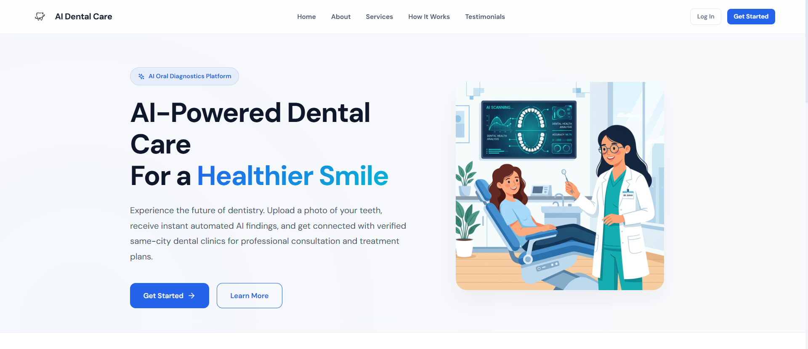

# AI Dental Care



##  Overview
AI Dental Care is an intelligent platform that leverages deep learning to assist dental professionals in diagnosis, treatment planning, and patient management. The system provides real‑time analysis of dental X‑rays, suggests optimal treatment pathways, and integrates seamlessly with existing practice management software.

## Key Features
- **Automated X‑ray Analysis**: Detect cavities, periodontal disease, and anomalies with high precision.
- **Treatment Recommendation Engine**: AI‑driven suggestions based on patient history and diagnostic results.
- **Workflow Integration**: RESTful APIs for easy integration with popular dental practice management tools.
- **Secure Data Handling**: End‑to‑end encryption, HIPAA‑compliant storage, and role‑based access control.
- **Responsive Dashboard**: Modern UI built with React 19 and Vite, offering real‑time visualizations.

## Installation
### Prerequisites
- Node.js >= 20
- Python >= 3.10 (for AI models)
- Docker (optional, for containerized deployment)

### Backend Setup
```bash
cd backend
# Create virtual environment
python -m venv venv
source venv/Scripts/activate  # Windows PowerShell
pip install -r requirements.txt
# Run migrations
alembic upgrade head
# Start the API server
uvicorn main:app --reload
```

### Frontend Setup
```bash
cd frontend
npm install
npm run dev
```

### Docker (All-in-One)
```bash
docker-compose up --build
```

## Usage
1. Open the dashboard at `http://localhost:5173`.
2. Upload a dental X‑ray image.
3. Review AI‑generated insights and recommended treatment plans.
4. Export reports or push data to your practice management system via the API.

## Architecture
- **Frontend**: React 19 + Vite, styled with a premium glassmorphism theme.
- **Backend**: FastAPI (Python) serving model inference and CRUD operations.
- **AI Engine**: PyTorch models hosted on a GPU‑enabled server, accessed via a gRPC microservice.
- **Database**: PostgreSQL for structured data, MinIO for object storage.
- **Authentication**: OAuth2 with JWT, supporting SSO providers.

## Contributing
Contributions are welcome! Please read our [CONTRIBUTING.md](CONTRIBUTING.md) for guidelines on code style, testing, and pull request procedures.

##  License
This project is licensed under the **MIT License** – see the [LICENSE](LICENSE) file for details.

## Acknowledgments
- **OpenCV** and **PyTorch** for the computer‑vision backbone.
- **Radiology AI community** for datasets and research insights.
- **Team Manoj-codes02** for continuous development and support.

---
© 2026 AI Dental Care. All rights reserved.
